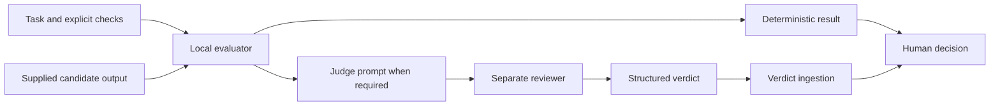

# claude-os

**Evaluate AI-assisted work before you trust it.**

claude-os is a public toolkit for checking supplied AI outputs against explicit requirements. It combines a Python evaluation runner, a linter for evaluation tasks, and a small collection of attributed review skills. It grew out of a personal Claude Code development system; this edition is designed to be useful without that private environment.

The central rule is simple: a generated answer, a passing deterministic check, and an independent review are different kinds of evidence. Keep them separate.

## Try it

Requires **Python 3.10 or newer**. The evaluator uses only the standard library. No API key, paid account, package installation, or global configuration is needed for the local examples.

```sh
git clone https://github.com/sharanlabs/claude-os-public.git
cd claude-os-public
python3 bin/eval-runner.py self-test
python3 -m unittest discover -s tests -v
```

Use `python` if that is how Python 3 is named on your system. See the [walkthrough](docs/WALKTHROUGH.md) for passing, failing, and incomplete evaluations.

## What you can use today

| Component | Purpose | Boundary |
|---|---|---|
| [Evaluation runner](bin/eval-runner.py) | Check text or JSON fields; prepare judge prompts; ingest structured verdicts | Evaluates supplied outputs. Does not generate them or call a model. |
| [Task linter](bin/golden-lint.py) | Flag evaluation designs that may reward the wrong behavior | Heuristics are advisory; a clean lint is not proof that a test is good. |
| [Synthetic examples](examples/) | Exercise positive, negative, and pending-review paths | Small fixtures for software behavior, not a model benchmark. |
| [Review skills](skills/) | Structure critique, requirements questioning, and source-grounded review | Optional agent instructions; live Codex use needs your own installation and access. |
| [Tests](tests/) | Exercise the real CLI and its exit behavior | Evidence for the covered cases, not a security certification. |

## How the pieces fit



The evaluator exits **0** for complete passing evaluations, **1** for failures, and **2** when required judgment is still pending. Treat only exit 0 as a completed pass. A separate `ingest-verdict` result does not automatically merge with an earlier run report; preserve and review both.

## What this release does not establish

The fixtures do not establish defect-detection rates, reduced maintenance time, or superiority over another reviewer. Token and latency values are supplied data, not measurements made by the runner. A model-generated verdict is still an assessment, not independent proof of correctness. See [evaluation limits](docs/EVALUATION.md).

The older `bin/audit.py`, `bin/hooks/`, and `agents/acceptance-gate.md` remain **reference material from the personal runtime**. They are not installed, enabled, or covered by the portable-toolkit CI. Some expect files and configuration that this public repository does not include. Do not use them as a fresh-clone installer or security boundary. The former public edition was a nonstandalone control-layer snapshot; this release adds a supported, runnable subset.

## Contribute

Start with a reproducible evaluation failure, an incorrectly scored candidate, or a confusing setup step. Small test cases with both a good and bad output are especially useful. Read [CONTRIBUTING.md](CONTRIBUTING.md), [security boundaries](SECURITY.md), and the [roadmap](docs/ROADMAP.md).

## License and provenance

Original project code is [MIT-licensed](LICENSE). Included third-party skills retain their own licenses and attribution; see [THIRD-PARTY-NOTICES.md](THIRD-PARTY-NOTICES.md). These integrations do not imply endorsement by OpenAI, Anthropic, or their upstream authors.

An earlier [claude-os-open architecture snapshot](https://github.com/sharanlabs/claude-os-open) is historical reference material. **This repository is the runnable public toolkit.**

Maintained by [Sharan Kumar](https://github.com/sharanlabs). [Release notes](CHANGELOG.md) · [Architecture](docs/ARCHITECTURE.md) · [Operating principles](docs/CONSTITUTION.md)
